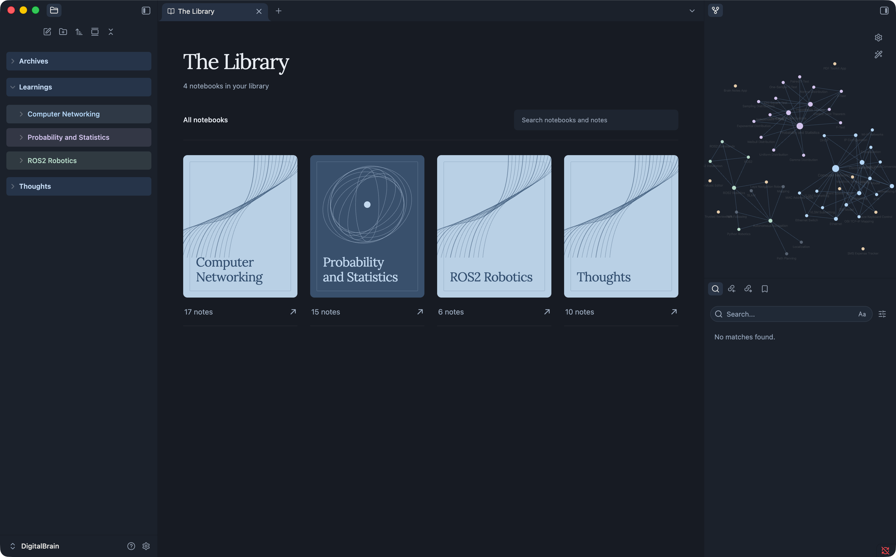

# The Library

A quiet home for your notes in **Obsidian**. Illustrated notebooks, soft blue accents, and comfortable reading—built around ordinary Markdown.



*The Library running in Obsidian, with topic notebooks and matching colours in the file panel and graph.*

### Open. Browse. Read.

- **Notebooks** — existing folders become browsable collections. An optional `Index.md` groups notes with headings and wikilinks.
- **Focused reading** — follow connections and resume your reading position. Read without editing controls, extra outlines, or related-note panels.
- **Clear navigation** — ordered notebook → topic → note breadcrumbs, with distinct folder sections in Obsidian’s explorer.
- **Notebook graph** — existing graph panes focus on the notebook and its direct connections, then restore when you return to the shelf.
- **One visual style** — a matching dark palette across the Library, Obsidian tabs, sidebars, search, and dialogs.

Breadcrumb topics come from notes tagged `hub` and their links. Graph focusing uses guarded Obsidian core APIs; native centering verification is still pending.

The Library opens on startup. Notes stay in their existing folders; cross-notebook links open the original file. Add or organize notebooks through Obsidian or your LLM’s file tools.

### Install

1. Build the project, then extract `dist/the-library-plugin.zip` into your vault’s `.obsidian/plugins/`.
2. Enable **The Library** under Community plugins.
3. Open it using the book icon or **The Library: Open learning workspace**.

The same files support desktop and Android. Physical Android testing is still pending. No account, telemetry, or AI API key is required.

### Develop

```sh
npm ci
npm run build
npm run package
```

Run `npm test`, `npm run typecheck`, and `npm run test:release` to verify. `npm run preview` opens the demonstration app locally.

[LLM connection](docs/installation/llm-connection.md) · [Note workflow](docs/workflows/llm-note-workflow.md) · [Verification](docs/testing/learning-workspace.md)
