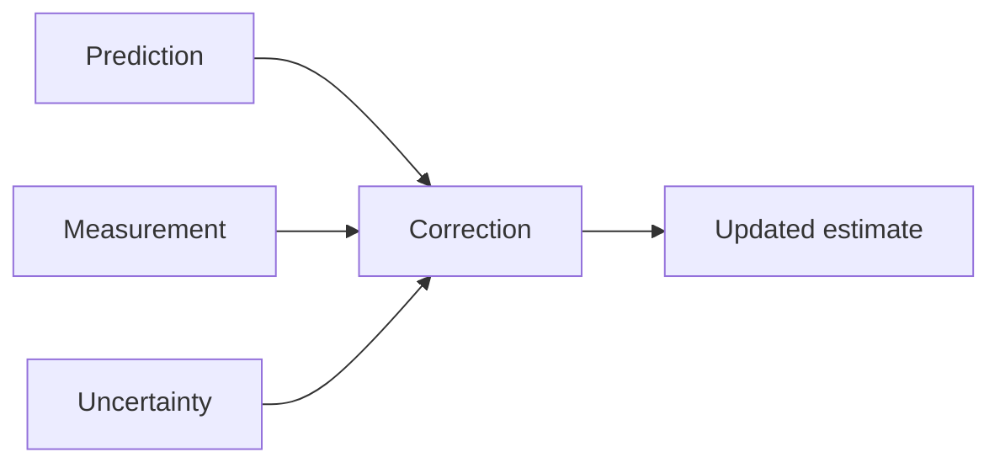

# Clear Learning Workspace Implementation Plan

> **For agentic workers:** REQUIRED SUB-SKILL: Use superpowers:executing-plans for native implementation or superpowers:subagent-driven-development if that execution method is explicitly selected. Steps use checkbox (`- [ ]`) syntax.

**Goal:** Build a clear Obsidian interface for one shared library of learning, ideas and references, with visual reading, active recall and the user's external-LLM note workflow.

**Architecture:** Existing Markdown files remain the content store. A topic index drives Home, Library, Topics and a reading pane; capture and study operate on those same notes. Optional local MCP tools provide managed writes after the browsing and learning experience works.

**Tech Stack:** TypeScript, Obsidian APIs, esbuild, Vitest, Zod, MCP SDK v2, native Mermaid/Canvas, optional Excalidraw/OSR, original scoped CSS and an optional theme.

**Spec:** [Clear learning workspace](../specs/2026-10-14-clear-learning-workspace-design.md).
**LLM guide:** [Note-making workflow](../../workflows/llm-note-workflow.md).
**Status:** 0.1.0 implementation built. See [verification report](../../testing/learning-workspace.md) for completed checks and remaining native/provider work. The checklist below remains the full target; not every integration is claimed complete.

## Global Constraints

- One searchable library across configured vault folders.
- Learning, Idea, and Reference are views/filters, not mandatory physical directories.
- No university, semester, syllabus, module, assessment, or exam-management hierarchy.
- Course tagging is never required to create, find, read, or review a note.
- Add a course tag only when the user supplies a code for that capture or explicitly asks to apply it.
- Existing-vault mode preserves paths and formatting.
- Unresolved links are visible without automatically creating files.
- Generating prompts is separate from enrolling them; tentative explanations stay out of memorization queues.
- No capture or reading completion awards mastery; the user assesses recall.
- The plugin has no LLM API key or required hosted chat service.
- Never overwrite an intervening human edit; multi-file writes are not filesystem-atomic.
- Public Ideaverse research informs appearance/navigation but does not establish full paid-vault parity.

## Review Focus

1. Mixed university/personal content appears in one library; an optional tag changes filtering, not storage or note identity (Tasks 2–4).
2. Search/filter/reading state survives navigation and restart; deleted/renamed notes and stale headings yield useful recovery (Tasks 2–3).
3. Unsupported claims, capture retries, transport loss and human edits do not cause memorized errors, duplicates or lost content (Tasks 4, 6–7).
4. Diagrams, Unicode/math and existing metadata survive rendering/editing; missing providers have visible fallbacks (Tasks 1, 3, 5–6).
5. Narrow screens and keyboard users can search, open, return and reveal without hover/hidden gestures; unloaded views release resources (Tasks 3, 6, 8–9).

## Baseline and layout

Planning registry versions checked 2026-10-14: obsidian 1.14.4, TypeScript 7.0.2, esbuild 0.28.2, Vitest 5.0.4, Zod 4.6.7, MCP server/client 2.3.1. Proposed exact pins, not tested compatibility. Companion/tests use Node 22.19+ on 22.x, 24.x or 26+; the initial native host validation target is Obsidian desktop 1.14.4. Keep the plugin's mobile-compatible core separate from lazy desktop Node bridge imports.

```text
src/main.ts, settings.ts
src/domain/{types,schemas}.ts
src/storage/{state-store,vault-port,obsidian-vault}.ts
src/index/vault-index.ts
src/topics/{topic-service,hub-renderer}.ts
src/views/{home,library,topics,reader,navigation,capture}-view.ts
src/capture/{capture-service,change-writer,recovery}.ts
src/study/{prompt-service,review-view}.ts
src/integrations/{diagrams,osr}.ts
src/templates/{learning,idea,reference,hub}.md
src/bridge/{server,tool-handlers}.ts
companion/{main,bridge-client}.ts
styles.css, theme/{manifest.json,theme.css}
tests/{domain,index,topics,views,capture,study,bridge,release}/
tests/helpers/memory-vault.ts
scripts/{build.mjs,package.mjs,generate-fixture.ts}
manifest.json, package.json, tsconfig.json, vitest.config.ts
```

## Milestones

1. **Browse and read:** Tasks 1–3 deliver the primary interface over existing notes.
2. **Capture and learn:** Tasks 4–6 add structured LLM capture, meaningful diagrams and recall.
3. **Connect external tools:** Task 7 adds managed local MCP authoring.
4. **Polish and validate:** Tasks 8–9 complete the visual experience and release checks.

Calendar, project administration and special collections are optional later extensions, not prerequisites or hidden scope of this release.

## Task 1: State, lifecycle and existing-vault compatibility

**Files:** Root build/config files; `src/main.ts`, `src/settings.ts`, `src/domain/{types,schemas}.ts`, `src/storage/{state-store,vault-port,obsidian-vault}.ts`, `tests/helpers/memory-vault.ts`, `tests/domain/state.test.ts`, `scripts/build.mjs`.
**Produces:** The complete spec types plus `ClearState { schemaVersion: 1; topicLinks: TopicLink[]; prompts: RecallPrompt[]; drafts: ChangeSet[]; receipts: Receipt[]; pins: string[]; positions: ReadingPosition[]; roles: Record<string, Role> }`.

```ts
interface VaultPort {
  read(path: string): Promise<NoteSnapshot | null>;
  create(path: string, markdown: string): Promise<void>;
  update(path: string, expectedRevision: string, markdown: string): Promise<void>;
}
```

- [ ] Add exact pins and `typecheck` (`tsc --noEmit`), `test` (`vitest run`), `build` (`node scripts/build.mjs`) scripts. Keep Obsidian external in the plugin bundle; no personal-vault install during development.
- [ ] Create the memory port: path/text map, SHA-256 revisions, create-only collisions, `writeCount`, and one-shot `failNext(path)`. Add `emptyState`, `validateRoute` and `parseNoteStyle` regression tests:

```ts
expect(emptyState().schemaVersion).toBe(1);
expect(validateRoute('../outside.md')).toEqual({ ok: false });
expect(validateRoute('Learnings/Covariance.md')).toEqual({ ok: true });
expect(parseNoteStyle('---\ndate: 2026-10-14\ntags: [math]\n---\nBody').frontmatter)
  .toBe('date: 2026-10-14\ntags: [math]');
```

- [ ] Run `npm test -- tests/domain/state.test.ts` and confirm failure, then implement normalized relative-path validation, strict schemas, metadata-preserving storage and version migrations. Future unknown state versions open read-only rather than reset.
- [ ] Register/dispose events, intervals and view components correctly. Run tests/typecheck/build and enable/disable twice in a disposable vault without creating notes or starting a bridge. Commit Task 1 only.

## Task 2: Unified index and topic navigation

**Files:** `src/index/vault-index.ts`, `src/topics/{topic-service,hub-renderer}.ts`, `tests/index/vault-index.test.ts`, `tests/topics/topics.test.ts`; modify main.
**Produces:** `findNotes(query: LibraryQuery): NoteSnapshot[]`; `onRename(oldPath: string, newPath: string): void`; `reconcile(): Promise<void>`; `mergeOwnedHub(current: string, links: string[]): string`.

- [ ] Add exactly three fixture notes: a learning note, an idea note, and a reference note that also serves as the topic hub. The learning note has optional `#course/CS101`. Test all notes appear without a role/tag filter; selecting a course tag returns the same canonical path; clearing it restores the library. Unresolved links never create notes.

```ts
expect(index.findNotes({ text: '', tags: [], sort: 'title' })).toHaveLength(3);
expect(index.findNotes({ text: 'covariance', tags: ['course/CS101'], sort: 'title' })[0].path)
  .toBe('Learnings/Covariance.md');
```

- [ ] Run the targeted tests and confirm failure. Implement title/alias → heading → body search ranking, case-insensitive tag matching, stable sorting, optional role mappings and incremental updates on metadata/file events. Build after layout readiness and expose Reconcile for external edits.
- [ ] Hubs remain ordinary Markdown. Replace only one correctly paired owned link section; preserve custom text. For no pair, insert a new section; malformed/multiple pairs return a conflict. Renames update topic links/prompts/pins/reading paths; deletions yield missing-target diagnostics.
- [ ] Verify searching with no course code or topic metadata still works. Run tests/typecheck/build; commit Task 2.

## Task 3: Home, library list and learning reader

**Files:** `src/views/{home,library,topics,reader,navigation}-view.ts`, `tests/views/workspace.test.ts`; modify main/settings/styles.
**Consumes:** Index, state and native Markdown rendering.
**Produces:** `openNote(path: string): Promise<void>`; `savePosition(position: ReadingPosition): void`; `restorePosition(path: string): ReadingPosition | null`; `layoutMode(width: number): 'desktop' | 'compact' | 'single'`.

- [ ] Write tests for pin/position persistence, renamed/deleted targets, clear-filter behavior, back/forward history and explicit layout boundaries:

```ts
expect(layoutMode(1280)).toBe('desktop');
expect(layoutMode(800)).toBe('compact');
expect(layoutMode(480)).toBe('single');
```

- [ ] Run `npm test -- tests/views/workspace.test.ts`, observe failure, then implement sidebar/list/reader navigation, resume topic, meaningful search excerpts and tags, sort/list-card toggles and visible empty/indexing states.
- [ ] Implement reader outline, reading-position restore, regular/heading wikilinks, related-note panel and Open in Obsidian Editor. Use native Markdown APIs and dispose rendering components when switching/unloading. Match supported diagram renderers; absent assets remain visible links.
- [ ] Persist query/filter/history state without exposing hidden answers. Inspect actual Obsidian for keyboard search → note → related note → back, restoring reading location, plus widths 1280/800/480. Run tests/typecheck/build and commit Task 3. This is the first usable deliverable.

## Task 4: Capture validation, writes, receipts and recovery

**Files:** Create `src/capture/{capture-service,change-writer,recovery}.ts`, `src/views/capture-view.ts`, `tests/capture/{capture-service,change-writer,recovery}.test.ts`; modify types/schemas/state/main.
**Produces:** `toCourseTag(code: string): string`; `proposeCapture(draft: CaptureDraft, vaultId: string): ChangeSet`; `applyChanges(changeSet: ChangeSet, requestId: string): Promise<Receipt>`; `getReceipt(requestId: string): Receipt | null`; `undoReceipt(requestId: string): Promise<Receipt>`. Clear validates/organizes already-authored content; it does not secretly call an LLM.

- [ ] Write failure cases for expected revision mismatch, absent-create collision, changed content with the same request ID, second-write failure, rollback conflict, preserved Unicode/math/frontmatter, and an attempt to enroll a tentative prompt. Tentative suggestions may remain unenrolled. A new-learning capture produces no recall ratings.

```ts
expect(toCourseTag('CS101')).toBe('course/CS101');
expect(() => toCourseTag('')).toThrow();
```

`toCourseTag` trims the explicitly supplied code and accepts letters, digits, underscores and hyphens; other characters produce a targeted validation error. It returns the tag name without `#`; Markdown insertion adds that marker. No course code is guessed or carried forward. Apply optional tags during proposal so the returned preview/receipt reflects the actual written content.
- [ ] Include the idempotency regression:

```ts
const first = await service.applyChanges(changeSet, 'request-1');
const second = await service.applyChanges(changeSet, 'request-1');
expect(second).toEqual(first);
expect(vault.writeCount).toBe(changeSet.writes.length);
```

`service` wraps the memory port; `changeSet` is a valid fixture with two absent-create writes; `writeCount` is defined in Task 1's helper. Run `npm test -- tests/capture` and observe failure.
- [ ] Implement schema/path/reference checks, all-file preflight, serial mutation queue and request-content digest. Persist journal before changes. Each existing-file update runs revision comparison in `Vault.process`; create uses create-only behavior. Journal checkpoints record before/after snapshots and metadata changes. Serialize registry persistence with the writer.
- [ ] On interruption or failure, checked recovery restores only unchanged after-write content; a mismatched revision yields an explicit partial receipt. `getReceipt` handles lost responses. UI shows affected paths/questions and offers checked undo, never silently rolling over manual edits. Implement draft mode/source/uncertainty fields and an optional explicitly supplied course code; raw transcript persistence is opt-in.
- [ ] Test that no explicit code creates no course tag, an explicit CS101 yields `#course/CS101`, and existing tags remain. Apply the tag only to the topic writes, not generated hub patches. Verify mixed-topic capture updates existing notes and creates only independently useful topics, and draft cancellation writes nothing. Run tests/typecheck/build plus manual conflict/restart recovery in fixture vault. Commit Task 4.

## Task 5: Visual note templates and LLM instructions

**Files:** Create `src/integrations/diagrams.ts`, `src/templates/{learning,idea,reference,hub}.md`, `tests/capture/templates.test.ts`, `tests/study/diagram-links.test.ts`; package `docs/workflows/llm-note-workflow.md` as a read-only resource; modify capture/settings.
**Produces:** `renderTemplate(role: Role, sections: Record<string, string>): string`; `resolveDiagram(path: string): { kind: 'mermaid' | 'excalidraw' | 'image' | 'canvas'; available: boolean }`.

- [ ] Tests: templates omit empty sections and H1 in compatibility mode, preserve existing metadata, keep body math/Unicode, and leave unresolved concept links untouched. Missing Excalidraw returns an available Markdown/image fallback rather than a false “drawing created” result.

```ts
const markdown = renderTemplate('learning', {
  mechanism: 'Prediction → correction; $P$ represents covariance.',
  examples: '', connections: '[[Missing Topic]]'
});
expect(markdown).toContain('$P$');
expect(markdown).toContain('[[Missing Topic]]');
expect(markdown).not.toContain('## Examples');
```
- [ ] Run tests, observe failure, then implement topic-first templates and adapters. Use a verified Excalidraw command or documented API when present; opening an existing drawing does not require inventing a creation API. Mermaid generation accepts source text with validation and renders through Obsidian's Markdown renderer. Store generated attachments in the selected asset folder, never temporary directories. Keep note-link companions for diagrams.
- [ ] Embed a process example:

````markdown

````

- [ ] Add export/import checks for image fallback and relative embeds; no missing asset is reported as successfully linked. Verify guide source-backed/tentative distinction and topic-aware search instructions against three fixtures. Run tests/build, open a generated visual note in Obsidian, commit Task 5.

## Task 6: Prompt-first study and one scheduler integration

**Files:** Create `src/study/{prompt-service,review-view}.ts`, `src/integrations/osr.ts`, `tests/study/{prompts,review,osr}.test.ts`; modify state/settings/main.
**Produces:** `buildStudySurface(prompt: RecallPrompt, revealed: boolean): { question: string; answer?: string }`; `eligiblePrompts(prompts: RecallPrompt[]): RecallPrompt[]`; `schedulerStatus(): { available: boolean; dueKnown: boolean }`.

- [ ] Regression tests:

```ts
expect(buildStudySurface(prompt, false)).toEqual({ question: prompt.question });
expect(buildStudySurface(prompt, true).answer).toBe(prompt.answer);
expect(eligiblePrompts([{ ...prompt, evidence: 'tentative' }])).toEqual([]);
expect(schedulerStatusWithoutOSR()).toEqual({ available: false, dueKnown: false });
```

`prompt` has source-backed evidence; `schedulerStatusWithoutOSR` is a test adapter factory. Run `npm test -- tests/study`, observe failure.
- [ ] Implement reveal gating, diagram reconstruction/application prompts, explicit user assessment and topic/tag filtering. Unrevealed answers must not leak via DOM text, tooltips or accessibility labels. Persist prompt IDs, answer-revision diagnostics and source locations. Completing capture or reading a page does not submit a grade.
- [ ] Verify the installed OSR command and documented Markdown syntax in the fixture vault. Adapter writes opted-in prompts through capture transactions, preserves scheduler-owned comments, and delegates ratings/dates. If no supported due-query interface exists, open OSR's queue without displaying fabricated due counts. Native study stays usable without OSR. Track revised answers for explicit re-review without rewriting scheduler confidence.
- [ ] Test duplicate prompt enrollment, a shared note reviewed once across two course tags, provider absence and exported diagram answers. Confirm FSRS card versus whole-note OSR distinction in documentation. Run tests/typecheck/build and one actual review session; commit Task 6.

## Task 7: External LLM tools through the local MCP companion

**Files:** Create `src/bridge/{server,tool-handlers}.ts`, `companion/{main,bridge-client}.ts`, `tests/bridge/{tools,transport}.test.ts`, `docs/installation/llm-connection.md`; modify build/main/settings.
**Produces:** the seven tools in the spec with identical names and schemas; `dispatchTool(name: string, input: unknown): Promise<unknown>`; `BridgeClient.call(name: string, input: unknown): Promise<unknown>`. Tool handlers consume earlier services; no duplicate file-writing backend.

- [ ] Write integration tests using an ephemeral loopback test server: exact tool listing, read → propose → apply → receipt, wrong vault/token rejection, closed bridge, malformed/oversized input, unsupported tool, stale revision, request retry after response loss. Assert no writes from proposal/read calls and no credential values in errors/logs.
- [ ] Run `npm test -- tests/bridge`, observe failure. Implement POST `/v1/rpc`, 1 MiB body cap, schema validation, explicit vault ID and token, loopback binding, host/origin checks, and shutdown cleanup. Store connection descriptor outside synced vault content with restrictive local permissions; settings show status, not the token. Disable desktop bridge on mobile and avoid loading Node bridge imports there.
- [ ] Build SDK registration with all seven real schemas. This small pattern is the exact v2 transport boundary; `handlers` and `schemas` are produced by `tool-handlers.ts`:

```ts
import { McpServer } from '@modelcontextprotocol/server';
import { serveStdio } from '@modelcontextprotocol/server/stdio';
serveStdio(() => {
  const server = new McpServer({ name: 'clear-notes', version: '0.1.0' });
  for (const name of Object.keys(schemas)) {
    server.registerTool(name, {
      description: descriptions[name], inputSchema: schemas[name]
    }, async input => ({
      content: [{ type: 'text', text: JSON.stringify(await handlers[name](input)) }]
    }));
  }
  return server;
});
```

`schemas`, `descriptions`, and `handlers` are maps over exactly the seven spec tool names; descriptions explain mutation and proposal boundaries. Companion handlers forward to `BridgeClient`, while plugin handlers call the services. Log only to stderr; stdout is MCP protocol.
- [ ] Add `clear://workflow` and `clear://workspace-policy` resources containing this workflow guide and sanitized policy. Provide sample client config pinned to an explicit descriptor/vault, but do not write the user's client settings automatically. Use SDK client tests to list/read/call tools through a spawned stdio process.
- [ ] Run tests/typecheck/build and connect one real external MCP host to the fixture vault. Confirm the LLM can update a shared topic, link a diagram, and receive a truthful receipt, then repeat request after simulated loss without duplicates. Record host/protocol versions. Commit Task 7.

## Task 8: UI polish, optional theme and clean setup

**Files:** `styles.css`, `theme/{manifest.json,theme.css}`, `tests/views/setup.test.ts`; modify navigation/settings.
**Produces:** `planSetup(existingPaths: string[], requestedPaths: string[]): string[]`; scoped visual tokens and optional global theme.

- [ ] Add a setup test before implementation:

```ts
expect(planSetup(['Learnings/Robotics.md'], ['Learnings/Robotics.md', 'Learnings/Math.md']))
  .toEqual(['Learnings/Math.md']);
```

- [ ] Run test, observe failure, then implement a setup preview for selected files/templates/assets that skips existing paths. Repeated setup is idempotent and never creates placeholder files for unresolved links.
- [ ] Refine readable cream/teal/purple styling, heading hierarchy, comfortable line lengths and responsive panes. Keep reading and diagrams visually primary, secondary metadata quiet, and every action visible. Theme is opt-in; local styling works with other themes.
- [ ] Verify focus, reduced motion, contrast, scrolling, missing-image states and theme/plugin unload in native Obsidian. Run tests/typecheck/build; commit Task 8.

## Task 9: Whole-system validation and release packaging

**Files:** Create `scripts/{package.mjs,generate-fixture.ts}`, `tests/release/package.test.ts`, `docs/testing/learning-workspace.md`; update README with concise install/use instructions.
**Produces:** `dist/clear-plugin.zip`, `dist/clear-theme.zip`, `dist/clear-mcp.zip`, and a runtime verification report with passed/failed/unverified checks.

Package archive inspection uses `fflate@0.8.3`, checked in the npm registry on 2026-10-14, as an exact dev dependency. `unzipSync` verifies actual archive contents. The release test is run against fresh packages, not stale build files:

```ts
const members = Object.keys(unzipSync(readFileSync('dist/clear-plugin.zip')));
expect(members.sort()).toEqual(['clear/main.js', 'clear/manifest.json', 'clear/styles.css']);
```

- [ ] Add artifact tests that inspect archive members and manifest/main/style paths, ensure `obsidian` is external, reject missing guide/resource/companion dependencies, and contain no source-map references to local secrets. Run test and observe failure before adding packaging.
- [ ] Separate artifact tests into `test:release` and exclude them from the normal pre-build unit suite. `npm run package` creates fresh archives; `npm run test:release` validates them. The first red run should fail on absent artifacts before packaging is implemented.
- [ ] Implement packaging with reproducible file lists and lockfile dependencies for the Node companion. Fixture generator produces topic hubs, a shared note with optional explicit course tags, notes with Unicode/math and 5,000 additional Markdown records. Keep fixture data outside the personal vault.
- [ ] Run `npm test`, `npm run typecheck`, `npm run build`, `npm run package`, and `npm run test:release` in that order. Inspect each artifact rather than assuming build implies installability.
- [ ] In a fresh disposable Obsidian vault execute: browse library/topic hub → ingest mixed blurt → inspect sources/uncertainty → update existing concept → create distinct topic → embed diagram → enroll selected prompt → answer/reveal/rate → edit/rename note externally → reconcile → retry receipt → unload/restart. Run failure recovery and provider-absence cases too. Document human rating separate from capture success.
- [ ] Measure index startup and affected-note updates on the generated fixture; record host/runtime and timings. Do not infer physical-device/mobile acceptance from desktop or browser checks. Validate a native mobile study/navigation subset only if a device is available, otherwise report unverified.
- [ ] Run a final requirements/plan coverage review and meaningful code review. Fix failures, then repeat only affected tests plus final package checks. Commit concise README and release-related changes locally. Do not push, publish, install into the user's live vault, or create a PR unless separately requested.

## Self-review and handoff

Spec coverage: unified navigation/reader in Tasks 1–3; optional explicit course tags and LLM note-making in Task 4; visuals in Task 5; recall in Task 6; seven local tools in Task 7; styling/setup and native/package checks in Tasks 8–9. No semester/course database or course-context tool remains. Review is optional and shares note identity with reading.

Recommend native implementation using superpowers:executing-plans because the services share tightly coupled path/revision/prompt contracts. Review this plan and active spec before implementation; the current work only revises planning documents.

Sources: [learning research](../../research/reports/Obsidian%20learning%20and%20recall.md), [Obsidian Vault API](https://docs.obsidian.md/Plugins/Vault), [MCP SDK v2](https://ts.sdk.modelcontextprotocol.io/v2/).
