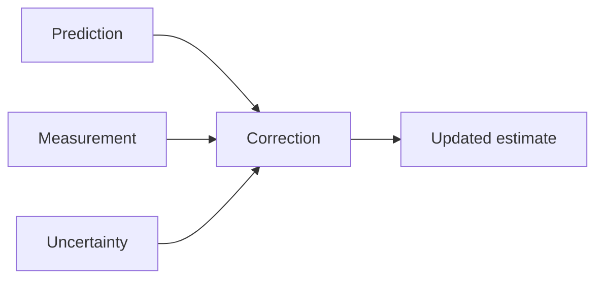

# Clear Student Learning Implementation Plan

> Superseded by [2026-10-14-clear-learning-workspace-plan.md](2026-10-14-clear-learning-workspace-plan.md). The user explicitly removed university-based organization; retain this document only as prior design context.

> **For agentic workers:** REQUIRED SUB-SKILL: Use superpowers:subagent-driven-development or superpowers:executing-plans to implement this plan task-by-task. Steps use checkbox (`- [ ]`) syntax for tracking.

**Goal:** Build an Obsidian system that organizes university and personal knowledge, turns external-LLM blurts into connected visual notes, and supports deliberate active recall.

**Architecture:** Markdown remains the content store. The plugin owns a course/topic registry, index, capture transactions, navigation and prompt-first study views. An optional local stdio MCP companion forwards typed operations to the open desktop plugin; existing LLM filesystem tools remain usable through the workflow guide and index reconciliation.

**Tech Stack:** TypeScript, Obsidian APIs, esbuild, Vitest, Zod, MCP TypeScript SDK v2; native Mermaid/Canvas; optional Excalidraw and Obsidian Spaced Repetition (OSR); separate original CSS theme.

**Spec:** [Clear student learning design](../specs/2026-10-14-clear-student-learning-design.md).
**LLM guide:** [Note-making workflow](../../workflows/llm-note-workflow.md).

**Status:** Planning complete; proposed for review. No product implementation, dependency installation, vault changes, or runtime validation has occurred. The user's request authorizes this revised plan; execution is a separate step.

## Global Constraints

- Default is existing-vault mode: user-selected paths, existing note style and metadata preserved, no automatic migrations.
- Course and module pages are readable Markdown hubs.
- Concepts can belong to multiple courses/modules, and to independent-learning hubs, without duplicate content.
- Capture counts and card counts are not mastery scores.
- Without a supplied syllabus, report coverage as unknown.
- Tentative explanations stay out of memorization queues.
- Generating a prompt is separate from enrolling it.
- The user records the rating; the LLM cannot set mastery or submit a scheduler rating based only on its own judgment.
- The plugin does not need an LLM API key.
- Ordinary note navigation and capture work without MCP.
- Multi-file updates are not represented as an atomic filesystem transaction.
- Never overwrite an intervening human edit.
- Public Ideaverse parity remains bounded by supplied evidence; exhaustive paid-vault functionality is not a release assertion.

## Review Focus

1. Two courses use the same concept with different examples: one canonical note, two memberships and retained context (Tasks 2–3).
2. Human editing, sync, retry or transport loss occurs during a capture: revisions prevent overwrites and the receipt/journal describes actual results (Tasks 4 and 7).
3. A confident-looking blurt or correction is unsupported: uncertainty remains visible, no automatic enrollment or mastery credit (Tasks 4–6).
4. Existing flat folders/frontmatter, Unicode/math and unresolved links: preserve style and content; show diagnostics instead of migration or phantom files (Tasks 1–5).
5. Scheduler/drawing plugin missing, bridge closed or mobile host: visible fallback works and no invented scheduler status appears (Tasks 6–9).

## Baseline and repository layout

Repository has README, icon and planning/research documents only. Build the first implementation here using an isolated checkout at execution time if needed. Do not install into the personal vault as a development shortcut.

Registry versions checked 2026-10-14: `obsidian@1.14.4`, `typescript@7.0.2`, `esbuild@0.28.2`, `vitest@5.0.4`, `zod@4.6.7`, `@modelcontextprotocol/server@2.3.1`, `@modelcontextprotocol/client@2.3.1`. These are proposed exact pins, not verified installed compatibility. Companion/tests require Node 22.19+ on the 22.x line, 24.x, or 26+; runtime baseline is Obsidian desktop 1.14.4. If metadata changes before execution, record the adjustment before introducing dependencies. Test older/mobile hosts separately rather than claiming them from the SDK version.

```text
src/
  main.ts                         lifecycle and command registration
  domain/types.ts                 shared spec types and versioned state
  domain/schemas.ts               Zod validation and limit rules
  storage/state-store.ts          persistence, migrations, registry export
  storage/vault-port.ts           testable file operations interface
  storage/obsidian-vault.ts        actual Vault API adapter
  index/vault-index.ts            incremental snapshots, links and search
  university/course-service.ts   semesters, courses, modules, membership
  university/hub-renderer.ts     deterministic generated hub sections
  capture/capture-service.ts      validated drafts and change sets
  capture/change-writer.ts        revisions, serial writes, journal, receipts
  capture/recovery.ts             checked rollback/undo and restart recovery
  study/prompt-service.ts         stable prompts and revision state
  study/review-view.ts            prompt-first reveal and user scoring
  integrations/osr.ts             documented scheduler adapter/fallback
  integrations/diagrams.ts        Mermaid, linked assets, Excalidraw/Canvas
  views/navigation-view.ts        shared navigation and breadcrumbs
  views/course-view.ts            ordered modules, coverage, exam filters
  views/capture-view.ts           capture context, draft, receipts/conflicts
  views/collection-view.ts        sort/filter/list/table/cards
  views/calendar-view.ts         daily notes and deadlines
  views/effort-view.ts            project intensities and ranking
  settings.ts                    routing, style, enrollment, integrations
  bridge/server.ts               lazy desktop loopback RPC
  bridge/tool-handlers.ts        shared typed operation dispatcher
companion/main.ts                stdio MCP entry
companion/bridge-client.ts       identity-bound local RPC client
tests/helpers/memory-vault.ts    revisioned fake and failure injection
tests/{domain,index,university,capture,study,bridge,views}/
theme/{manifest.json,theme.css}
scripts/{build.mjs,package.mjs,generate-fixture.ts}
docs/{testing,installation}/
manifest.json, styles.css, package.json, tsconfig.json, vitest.config.ts
```

One implementation plan is appropriate because these features share the same note identity, membership, revision and prompt contracts. Deliver in the following four usable milestones; do not call the full system complete at an earlier milestone:

1. **Navigate:** Tasks 1–3 produce course/topic navigation over existing notes.
2. **Author and learn:** Tasks 4–6 produce managed captures, visual topic notes and study.
3. **Connect the LLM:** Task 7 produces working external tools and tested retries.
4. **Complete and ship:** Tasks 8–9 retain remaining workflows, theme and release validation.

## Task 1: Shared state and Obsidian lifecycle

**Files:** Create root build/config files, `src/main.ts`, `src/settings.ts`, `src/domain/{types,schemas}.ts`, `src/storage/{state-store,vault-port,obsidian-vault}.ts`, `tests/helpers/memory-vault.ts`, `tests/domain/state.test.ts`, `scripts/build.mjs`.

**Interfaces:** Copy the full domain model from the spec. Add `ClearState { schemaVersion: 1; semesters: Semester[]; courses: Course[]; modules: Module[]; syllabus: SyllabusItem[]; assessments: Assessment[]; memberships: Membership[]; prompts: RecallPrompt[]; drafts: ChangeSet[]; receipts: Receipt[] }`. The storage boundary is:

```ts
interface VaultPort {
  read(path: string): Promise<NoteSnapshot | null>;
  create(path: string, markdown: string): Promise<void>;
  update(path: string, expectedRevision: string, markdown: string): Promise<void>;
}
```

- [ ] Add pinned dependencies and scripts: `typecheck` runs `tsc --noEmit`; `test` runs `vitest run`; `build` runs `node scripts/build.mjs`. Keep `obsidian` external in plugin bundles. Produce `dist/plugin/main.js` and separate Node companion entry when added in Task 7; import desktop bridge code only behind the desktop capability guard.
- [ ] Implement a memory test port with a path-to-text map, SHA-256 revisions, and exact create/update conflict behavior. Add `failNext(path)` for a one-shot injected write failure. These are test fixtures, not a second production file backend.
- [ ] Write and run the failing regression:

```ts
const original = '---\ndate: 2026-10-14\ntags: [math]\n---\n\nA → B\n';
const state = emptyState();
expect(state.schemaVersion).toBe(1);
expect(validateRoute('../outside.md')).toEqual({ ok: false });
expect(validateRoute('Learnings/Covariance.md')).toEqual({ ok: true });
expect(parseNoteStyle(original).frontmatter).toBe('date: 2026-10-14\ntags: [math]');
```

`emptyState`, `validateRoute`, and `parseNoteStyle` are produced by this task. Run `npm test -- tests/domain/state.test.ts`; initially fail because these functions do not exist.
- [ ] Implement defaults, strict normalized relative Markdown paths, hidden-folder/path traversal rejection, versioned migrations, and frontmatter round-trip preservation. Read-only fallback on unknown future schema. Register listeners with `registerEvent`; dispose views, timers, bridge and subscriptions on unload. Unknown metadata must survive migrations.
- [ ] Run the test, `npm run typecheck`, and `npm run build`. In a disposable vault verify enabling/disabling twice produces one listener set, no network bridge until enabled, and no note creation. Commit only Task 1 files.

## Task 2: Incremental note index and shared-topic discovery

**Files:** Create `src/index/vault-index.ts`, `tests/index/vault-index.test.ts`; modify `src/main.ts`.
**Consumes:** `NoteSnapshot`, `Membership`, `VaultPort`.
**Produces:** `findNotes(query: string, memberships: Membership[], limit: number): NoteSnapshot[]`; `onRename(oldPath: string, newPath: string): void`; `reconcile(): Promise<void>`. Index content, filenames, headings and existing aliases without adding properties.

- [ ] Write a fixture test with one `Learnings/Fourier Transform.md` assigned to two course modules; assert both filtered searches return that same path, not duplicate notes. Verify a renamed path replaces its old key and an unresolved `[[Missing Topic]]` never creates a file.
- [ ] Run `npm test -- tests/index/vault-index.test.ts`, observe failure, then implement index maps and deterministic search scoring: exact title/alias, heading matches, then content matches. Resolve links through host metadata; treat empty/unavailable metadata explicitly. Build on layout-ready, update affected entries on metadata/file events, debounce only duplicate notifications, and expose a full reconcile command for external file edits.
- [ ] Use this membership predicate, with optional course/module filters passed explicitly in the service rather than guessed from the query:

```ts
const inCourse = (path: string, courseId: string, memberships: Membership[]) =>
  memberships.some(m => m.notePath === path && m.courseId === courseId);
```

- [ ] Verify rename/delete updates memberships and prompt paths; missing headings appear in diagnostics. Run tests/typecheck/build. Commit Task 2.

## Task 3: University navigator and readable course hubs

**Files:** Create `src/university/{course-service,hub-renderer}.ts`, `src/views/{navigation-view,course-view}.ts`, `tests/university/course-service.test.ts`, `tests/views/course-view.test.ts`; modify settings/main.
**Produces:** `assignTopic(membership: Membership): void`, `renderModuleLinks(module: Module, memberships: Membership[]): string`, `mergeOwnedHub(current: string, links: string[]): string`, `getCourseContext(courseId: string, moduleId?: string): CourseContext`. Define `CourseContext { course: Course; modules: Module[]; memberships: Membership[]; syllabus: SyllabusItem[]; assessments: Assessment[]; syllabusKnown: boolean }` here. Missing references cannot establish syllabus completeness.

- [ ] Tests: assigning the same membership twice is idempotent; the same note can join two courses; missing syllabus produces `syllabusKnown: false`; duplicate course codes in different semesters retain distinct IDs. Test custom paragraphs surrounding the generated hub block are unchanged.

```ts
const result = mergeOwnedHub('My study order.\n', ['- [[Covariance]]']);
expect(result).toContain('My study order.');
expect(result).toContain('- [[Covariance]]');
expect(mergeOwnedHub(result, ['- [[Covariance]]'])).toBe(result);
```
- [ ] Run targeted tests and observe failures. Implement semester/course/module forms, ordered topic memberships, materials and assessment records. Render only owned sections:

```ts
const ownedLinks = (links: string[]) =>
  ['<!-- clear:topics:start -->', ...links, '<!-- clear:topics:end -->'].join('\n');
```

Validate there is exactly zero or one matching marker pair before replacing; zero inserts a new section, malformed/multiple pairs return a conflict. Keep ordinary wikilinks and preserve manual learning-order commentary outside the owned block.
- [ ] Implement keyboard-accessible hierarchy, breadcrumbs, course text search, unknown/partial/captured coverage labels and exam filters. No topic is marked mastered. No file is created for a missing syllabus link. Run tests/typecheck/build and manually follow a hub → module → shared-topic link in the disposable vault. Commit Task 3.

## Task 4: Capture validation, writes, receipts and recovery

**Files:** Create `src/capture/{capture-service,change-writer,recovery}.ts`, `src/views/capture-view.ts`, `tests/capture/{capture-service,change-writer,recovery}.test.ts`; modify types/schemas/state/main.
**Produces:** `proposeCapture(draft: CaptureDraft, vaultId: string): ChangeSet`; `applyChanges(changeSet: ChangeSet, requestId: string): Promise<Receipt>`; `getReceipt(requestId: string): Receipt | null`; `undoReceipt(requestId: string): Promise<Receipt>`. Clear validates/organizes already-authored content; it does not secretly call an LLM.

- [ ] Write failure cases for expected revision mismatch, absent-create collision, changed content with the same request ID, second-write failure, rollback conflict, preserved Unicode/math/frontmatter, and an attempt to enroll a tentative prompt. Tentative suggestions may remain unenrolled. A new-learning capture produces no recall ratings.
- [ ] Include the idempotency regression:

```ts
const first = await service.applyChanges(changeSet, 'request-1');
const second = await service.applyChanges(changeSet, 'request-1');
expect(second).toEqual(first);
expect(vault.writeCount).toBe(changeSet.writes.length);
```

`service` wraps the memory port; `changeSet` is a valid fixture with two absent-create writes; `writeCount` is defined in Task 1's helper. Run `npm test -- tests/capture` and observe failure.
- [ ] Implement schema/path/reference checks, all-file preflight, serial mutation queue and request-content digest. Persist journal before changes. Each existing-file update runs revision comparison in `Vault.process`; create uses create-only behavior. Journal checkpoints record before/after snapshots and metadata changes. Serialize registry persistence with the writer.
- [ ] On interruption or failure, checked recovery restores only unchanged after-write content; a mismatched revision yields an explicit partial receipt. `getReceipt` handles lost responses. UI shows affected paths/questions and offers checked undo, never silently rolling over manual edits. Implement draft context selectors and source/uncertainty fields; raw transcript persistence is opt-in.
- [ ] Verify mixed-topic capture updates existing notes and creates only independently useful topics, and draft cancellation writes nothing. Run tests/typecheck/build plus manual conflict/restart recovery in fixture vault. Commit Task 4.

## Task 5: Visual note templates and LLM instructions

**Files:** Create `src/integrations/diagrams.ts`, `src/templates/{learning,idea,reference,course,module}.md`, `tests/capture/templates.test.ts`, `tests/study/diagram-links.test.ts`; package `docs/workflows/llm-note-workflow.md` as a read-only resource; modify capture/settings.
**Produces:** `renderTemplate(role: Role, sections: Record<string, string>): string`; `resolveDiagram(path: string): { kind: 'mermaid' | 'excalidraw' | 'image' | 'canvas'; available: boolean }`.

- [ ] Tests: templates omit empty sections and H1 in compatibility mode, preserve existing metadata, keep body math/Unicode, and leave unresolved concept links untouched. Missing Excalidraw returns an available Markdown/image fallback rather than a false “drawing created” result.

```ts
const markdown = renderTemplate('learning', {
  mechanism: 'Prediction → correction; $P$ represents covariance.',
  examples: '', connections: '[[Missing Topic]]'
});
expect(markdown).toContain('$P$');
expect(markdown).toContain('[[Missing Topic]]');
expect(markdown).not.toContain('## Examples');
```
- [ ] Run tests, observe failure, then implement topic-first templates and adapters. Use a verified Excalidraw command or documented API when present; opening an existing drawing does not require inventing a creation API. Mermaid generation accepts source text with validation and renders through Obsidian's Markdown renderer. Store generated attachments in the selected asset folder, never temporary directories. Keep note-link companions for diagrams.
- [ ] Embed a process example:

````markdown

````

- [ ] Add export/import checks for image fallback and relative embeds; no missing asset is reported as successfully linked. Verify guide source-backed/tentative distinction and course-aware search instructions against three fixtures. Run tests/build, open a generated visual note in Obsidian, commit Task 5.

## Task 6: Prompt-first study and one scheduler integration

**Files:** Create `src/study/{prompt-service,review-view}.ts`, `src/integrations/osr.ts`, `tests/study/{prompts,review,osr}.test.ts`; modify state/settings/main.
**Produces:** `buildStudySurface(prompt: RecallPrompt, revealed: boolean): { question: string; answer?: string }`; `eligiblePrompts(prompts: RecallPrompt[]): RecallPrompt[]`; `schedulerStatus(): { available: boolean; dueKnown: boolean }`.

- [ ] Regression tests:

```ts
expect(buildStudySurface(prompt, false)).toEqual({ question: prompt.question });
expect(buildStudySurface(prompt, true).answer).toBe(prompt.answer);
expect(eligiblePrompts([{ ...prompt, evidence: 'tentative' }])).toEqual([]);
expect(schedulerStatusWithoutOSR()).toEqual({ available: false, dueKnown: false });
```

`prompt` has source-backed evidence; `schedulerStatusWithoutOSR` is a test adapter factory. Run `npm test -- tests/study`, observe failure.
- [ ] Implement reveal gating, diagram reconstruction/application prompts, explicit user assessment and course/module/topic filtering. Unrevealed answers must not leak via DOM text, tooltips or accessibility labels. Persist prompt IDs, answer-revision diagnostics and source locations. Completing capture or reading a page does not submit a grade.
- [ ] Verify the installed OSR command and documented Markdown syntax in the fixture vault. Adapter writes opted-in prompts through capture transactions, preserves scheduler-owned comments, and delegates ratings/dates. If no supported due-query interface exists, open OSR's queue without displaying fabricated due counts. Native study stays usable without OSR. Track revised answers for explicit re-review without rewriting scheduler confidence.
- [ ] Test duplicate prompt enrollment, a shared topic reviewed once across two courses, provider absence and exported diagram answers. Confirm FSRS card versus whole-note OSR distinction in documentation. Run tests/typecheck/build and one actual review session; commit Task 6.

## Task 7: External LLM tools through the local MCP companion

**Files:** Create `src/bridge/{server,tool-handlers}.ts`, `companion/{main,bridge-client}.ts`, `tests/bridge/{tools,transport}.test.ts`, `docs/installation/llm-connection.md`; modify build/main/settings.
**Produces:** the eight tools in the spec with identical names and schemas; `dispatchTool(name: string, input: unknown): Promise<unknown>`; `BridgeClient.call(name: string, input: unknown): Promise<unknown>`. Tool handlers consume earlier services; no duplicate file-writing backend.

- [ ] Write integration tests using an ephemeral loopback test server: exact tool listing, read → propose → apply → receipt, wrong vault/token rejection, closed bridge, malformed/oversized input, unsupported tool, stale revision, request retry after response loss. Assert no writes from proposal/read calls and no credential values in errors/logs.
- [ ] Run `npm test -- tests/bridge`, observe failure. Implement POST `/v1/rpc`, 1 MiB body cap, schema validation, explicit vault ID and token, loopback binding, host/origin checks, and shutdown cleanup. Store connection descriptor outside synced vault content with restrictive local permissions; settings show status, not the token. Disable desktop bridge on mobile and avoid loading Node bridge imports there.
- [ ] Build SDK registration with all eight real schemas. This small pattern is the exact v2 transport boundary; `handlers` and `schemas` are produced by `tool-handlers.ts`:

```ts
import { McpServer } from '@modelcontextprotocol/server';
import { serveStdio } from '@modelcontextprotocol/server/stdio';
serveStdio(() => {
  const server = new McpServer({ name: 'clear-notes', version: '0.1.0' });
  for (const name of Object.keys(schemas)) {
    server.registerTool(name, {
      description: descriptions[name], inputSchema: schemas[name]
    }, async input => ({
      content: [{ type: 'text', text: JSON.stringify(await handlers[name](input)) }]
    }));
  }
  return server;
});
```

`schemas`, `descriptions`, and `handlers` are maps over exactly the spec tool names; descriptions explain mutation and proposal boundaries. Companion handlers forward to `BridgeClient`, while plugin handlers call the services. Log only to stderr; stdout is MCP protocol.
- [ ] Add `clear://workflow` and `clear://workspace-policy` resources containing this workflow guide and sanitized policy. Provide sample client config pinned to an explicit descriptor/vault, but do not write the user's client settings automatically. Use SDK client tests to list/read/call tools through a spawned stdio process.
- [ ] Run tests/typecheck/build and connect one real external MCP host to the fixture vault. Confirm the LLM can update a course topic, link a diagram, and receive a truthful receipt, then repeat request after simulated loss without duplicates. Record host/protocol versions. Commit Task 7.

## Task 8: Calendar, Efforts, Collections, Garden and optional theme

**Files:** Create remaining view files from layout, `theme/{manifest.json,theme.css}`, `styles.css`, `tests/views/{calendar,efforts,collections,garden}.test.ts`; modify templates/settings/navigation.
**Produces:** `dailyPath(date: string, folder: string): string`; `rankEfforts(items: Effort[]): Effort[]`; `queryCollection(query: CollectionQuery): NoteSnapshot[]`; `gardenCandidates(notes: NoteSnapshot[], mode: string): NoteSnapshot[]`. Define `Effort { notePath: string; intensity: 'active' | 'simmering' | 'sleeping'; rank: number }` and `CollectionQuery { role?: Role; text?: string; courseId?: string; sort: 'title' | 'modified' }` here.

- [ ] Tests cover local-date/year boundaries and create-only daily append, ranked intensities without metadata loss, deterministic collection sorting/filtering, and garden actions distinct from review grades. Missing/deleted note targets yield diagnostics. Course archiving preserves memberships and shared-topic enrollments.

```ts
expect(dailyPath('2027-01-01', 'Archives')).toBe('Archives/2027-01-01.md');
const items: Effort[] = [
  { notePath: 'B.md', rank: 2, intensity: 'simmering' },
  { notePath: 'A.md', rank: 2, intensity: 'active' }
];
expect(rankEfforts(items).map(x => x.notePath)).toEqual(['A.md', 'B.md']);
expect(items[0].intensity).toBe('simmering');
```
- [ ] Run tests and observe failures. Implement existing-vault folder/property mappings, editable saved views, list/table/cards with missing-cover fallback, deadlines distinct from learning intervals, and explicit idea/gap revisit actions. Starter setup previews owned files and skips existing notes idempotently; it never populates personal/demo content.
- [ ] Use stable effort ordering, including tie handling:

```ts
const byRank = (a: Effort, b: Effort) =>
  b.rank - a.rank || a.notePath.localeCompare(b.notePath);
```

- [ ] Implement original cream/teal/purple theme variables, scoped study/course views, visual hierarchy and optional global theme. Test visible controls, keyboard navigation, overflow, light/dark contrast, disabled/unloaded plugin and theme restoration. Native Graph complements topic navigation without promising conceptual mastery.
- [ ] Run targeted tests/typecheck/build and actual Obsidian visual checks for Home, course hub, topic, diagram, review and capture modal. Record narrow-layout/device checks separately. Commit Task 8.

## Task 9: Whole-system validation and release packaging

**Files:** Create `scripts/{package.mjs,generate-fixture.ts}`, `tests/release/package.test.ts`, `docs/testing/student-workflow.md`; update README with concise install/use instructions.
**Produces:** `dist/clear-plugin.zip`, `dist/clear-theme.zip`, `dist/clear-mcp.zip`, and a runtime verification report with passed/failed/unverified checks.

Package archive inspection uses `fflate@0.8.3`, checked in the npm registry on 2026-10-14, as an exact dev dependency. `unzipSync` verifies actual archive contents. The release test is run against fresh packages, not stale build files:

```ts
const members = Object.keys(unzipSync(readFileSync('dist/clear-plugin.zip')));
expect(members.sort()).toEqual(['clear/main.js', 'clear/manifest.json', 'clear/styles.css']);
```

- [ ] Add artifact tests that inspect archive members and manifest/main/style paths, ensure `obsidian` is external, reject missing guide/resource/companion dependencies, and contain no source-map references to local secrets. Run test and observe failure before adding packaging.
- [ ] Separate artifact tests into `test:release` and exclude them from the normal pre-build unit suite. `npm run package` creates fresh archives; `npm run test:release` validates them. The first red run should fail on absent artifacts before packaging is implemented.
- [ ] Implement packaging with reproducible file lists and lockfile dependencies for the Node companion. Fixture generator produces course/module hubs, a cross-course shared topic, notes with Unicode/math and 5,000 additional Markdown records. Keep fixture data outside the personal vault.
- [ ] Run `npm test`, `npm run typecheck`, `npm run build`, `npm run package`, and `npm run test:release` in that order. Inspect each artifact rather than assuming build implies installability.
- [ ] In a fresh disposable Obsidian vault execute: create university/course/module → ingest mixed blurt → inspect sources/uncertainty → update existing concept → create distinct topic → embed diagram → enroll selected prompt → answer/reveal/rate → edit/rename note externally → reconcile → retry receipt → unload/restart. Run failure recovery and provider-absence cases too. Document human rating separate from capture success.
- [ ] Measure index startup and affected-note updates on the generated fixture; record host/runtime and timings. Do not infer physical-device/mobile acceptance from desktop or browser checks. Validate a native mobile study/navigation subset only if a device is available, otherwise report unverified.
- [ ] Run a final requirements/plan coverage review and meaningful code review. Fix failures, then repeat only affected tests plus final package checks. Commit concise README and release-related changes locally. Do not push, publish, install into the user's live vault, or create a PR unless separately requested.

## Self-review and handoff

All spec surfaces map to Tasks 1–9. Typed LLM writes, human edits and retry recovery belong to Task 4; both external-tool transports use that same service in Task 7. Exact documented provider integration is verified in Task 6; unsupported APIs have a concrete fallback. No host/runtime or parity claim precedes evidence.

Recommended execution method: native implementation in this session, using `superpowers:executing-plans`, because interfaces are tightly dependent and one implementer can keep the shared revision/membership/prompt contracts consistent. A final independent reviewer can check the complete branch. Before execution, review this plan and its spec; implementation has not started.

References: [Obsidian Vault API](https://docs.obsidian.md/Plugins/Vault), [lifecycle events](https://docs.obsidian.md/Plugins/Events), [MCP SDK v2](https://ts.sdk.modelcontextprotocol.io/v2/), [prior learning/plugin research](../../research/reports/Obsidian%20learning%20and%20recall.md).
